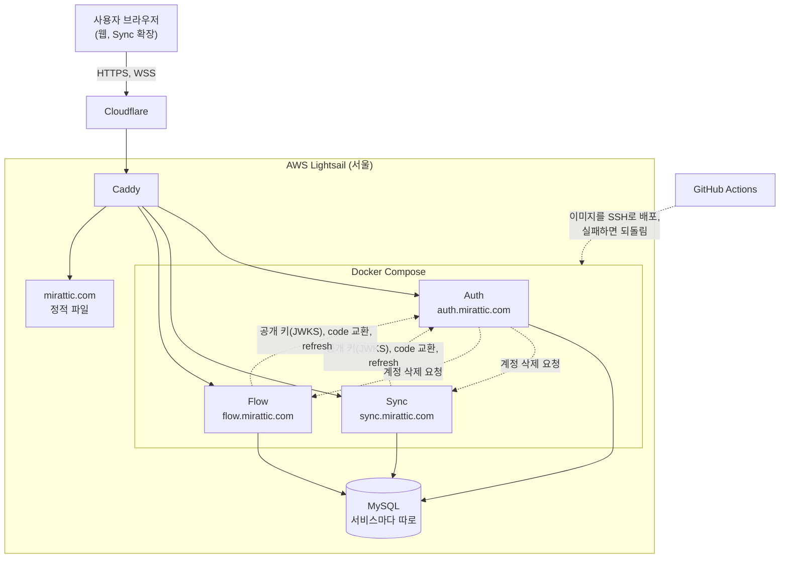

  

<h1 align="center">함께 보고, 함께 일하는 곳.</h1>

  Mirattic은 친구와 영상을 같은 순간에 보는 <b>Mirattic Sync</b>와, 
  팀이 이슈와 대화를 한곳에서 나누는 <b>Mirattic Flow</b>를 만듭니다. 
  계정 하나로 둘 다 씁니다.

  <a href="https://sync.mirattic.com"> Mirattic Sync</a>
  &nbsp;·&nbsp;
  <a href="https://flow.mirattic.com"> Mirattic Flow</a>
  &nbsp;·&nbsp;
  <a href="https://auth.mirattic.com"> 내 계정</a>

---

##  Mirattic Sync

친구랑 같은 영상을 같은 초에 보는 Chrome 확장입니다.

방장이 재생하거나 멈추거나 넘기면 다른 사람 화면도 그대로 따라갑니다. 영상은 각자 자기 브라우저에서 틀고, 녹화하거나 중계하지 않습니다. 이야기는 영상을 가리지 않는 옆 패널에서 합니다.

|  YouTube |  Netflix |  라프텔 |
|:---:|:---:|:---:|
| 지원 | 실험 | 실험 |

[Sync 살펴보기](https://sync.mirattic.com)

##  Mirattic Flow

팀이 이슈와 대화를 한 화면에서 다루는 협업 도구입니다.

워크스페이스 안에서 프로젝트와 이슈를 관리하고, 담당자와 우선순위, 마감일, 상태를 한눈에 봅니다. 이슈 옆에서 바로 채팅할 수 있어서 이야기한 내용이 그 이슈에 남고, 알림과 대시보드로 내 담당과 진행 상황을 챙깁니다.

[Flow 시작하기](https://flow.mirattic.com)

##  Mirattic 계정

계정 하나로 Sync와 Flow에 같이 들어갑니다. 카카오, 네이버, Google 중 편한 걸로 가입하면 됩니다.

비밀번호는 Mirattic 계정 화면에서만 입력하고, 각 서비스는 비밀번호를 받지도 저장하지도 않습니다. 로그인된 기기나 최근 보안 활동 확인, 탈퇴는 [내 계정](https://auth.mirattic.com)에서 직접 할 수 있습니다.

---

## 어떻게 돌아가나요

서비스 세 개와 이 소개 페이지를 혼자 설계하고, 만들고, 배포하고, 운영하고 있습니다. 서비스마다 저장소가 따로 있고, 각 README에 고민했던 것들을 적어 두었습니다.

| 저장소 | 하는 일 | 주로 쓴 것 | 이야기할 거리 |
| --- | --- | --- | --- |
| [mirattic-auth](https://github.com/G1Se0k/mirattic-auth) | 계정과 로그인 | Spring Authorization Server, MySQL | OAuth 2.0 / OIDC, refresh token 도용 감지, 서명 키 무중단 교체, 서비스를 넘나드는 계정 삭제 |
| [mirattic-sync](https://github.com/G1Se0k/mirattic-sync) | 같이 보기 확장과 서버 | Spring Boot, Raw WebSocket, MySQL, TypeScript | 서버 시계 맞추기, 어긋남 보정, DB 행 잠금으로 지키는 방 상태, 로컬 부하 테스트(M3 Max)에서 동시 8,000 연결 p95 73ms |
| [MiratticFlow](https://github.com/G1Se0k/MiratticFlow) | 팀 협업, 이슈 관리 | Spring Boot, STOMP, MySQL, Next.js | 권한 검사를 한 곳에 모으기, 실시간 채팅과 알림, 집계는 DB에 맡기기 |
| mirattic-main (여기) | mirattic.com 소개 페이지 | 정적 HTML | |

로그인은 Auth 한 곳에서만 합니다. Sync와 Flow는 로그인 버튼을 누르면 Auth로 보내고, 돌아온 토큰은 Auth의 공개 키로 직접 검증합니다(서명, 발급자, 대상, 만료).

DB는 서비스마다 따로 둡니다. 서로의 DB를 읽지 않고 사용자 ID로만 이어지기 때문에, 계정 삭제처럼 여러 서비스에 걸친 일은 Auth가 서명한 요청을 각 서비스에 보내서 처리합니다.

배포 방식은 세 서비스가 같습니다. GitHub Actions가 만든 이미지를 레지스트리 없이 SSH로 서버에 보내고, 서버의 스크립트가 헬스 체크를 해 보고 바꾸거나 되돌립니다. Auth와 Sync는 테스트를 통과해야 배포되고, 이 소개 페이지는 정적 파일만 복사합니다.
DB는 매일 백업하고, 5분마다 각 서비스가 살아 있는지 확인해서 실패하면 GitHub 알림으로 받습니다. 서버 방화벽은 웹 포트를 Cloudflare에서 오는 요청에만 열어 둡니다.

처음엔 집에 있는 Mac mini에서 돌리다가 2026년 10월 3일에 AWS Lightsail로 옮겼습니다. 실제 백업으로 리허설을 먼저 해 보고, 서비스 하나씩 몇 분 안에 넘겼습니다.

---

이 저장소에 대하여

[mirattic.com](https://mirattic.com) 소개 페이지의 소스입니다. 빌드 없는 정적 페이지라서 `public/`(`index.html`과 `assets/`)만 공개됩니다.

`main`에 푸시하면 GitHub Actions가 `public/`을 rsync로 서버의 Caddy 루트에 복사하고, 사이트가 응답하는지 확인합니다. 서버 주소는 GitHub Secrets에 있습니다.

로컬에서 보려면 `python3 -m http.server 8765 -d public`을 실행하고 http://127.0.0.1:8765 를 열면 됩니다.

© 2026 Mirattic

