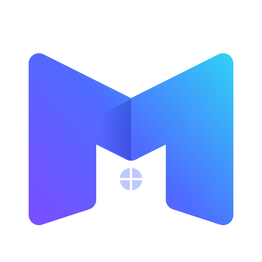
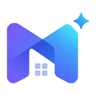
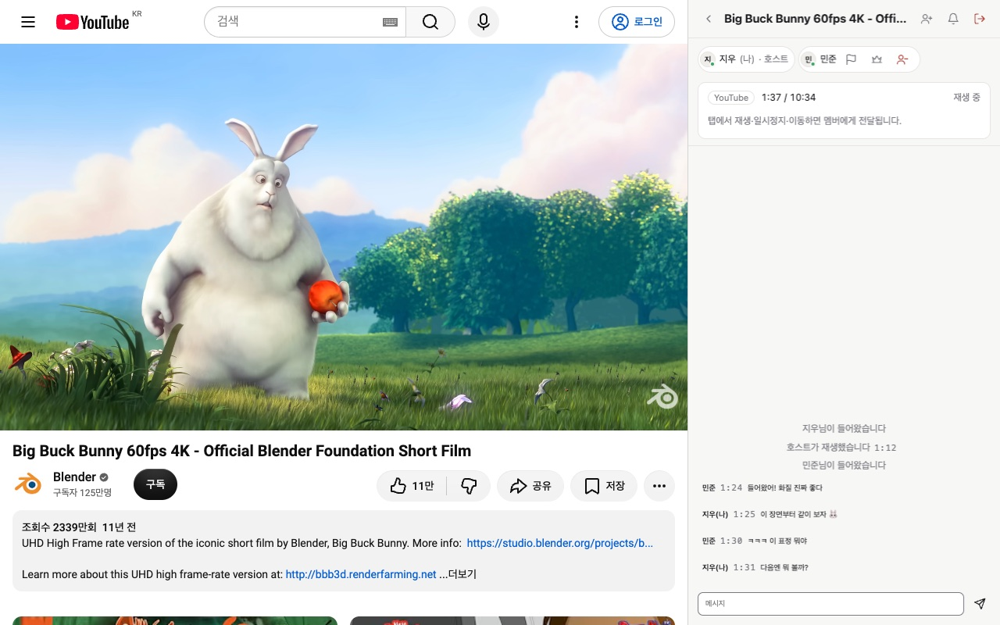
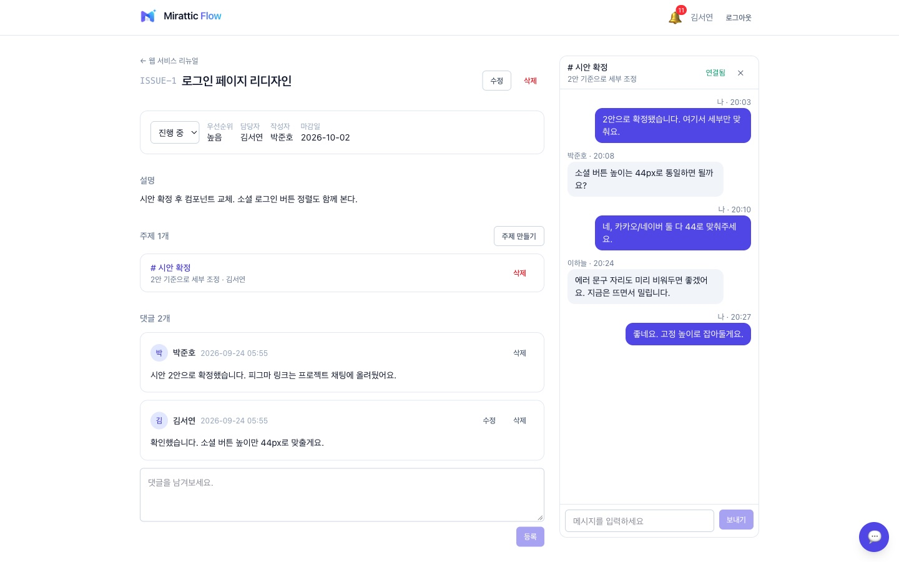
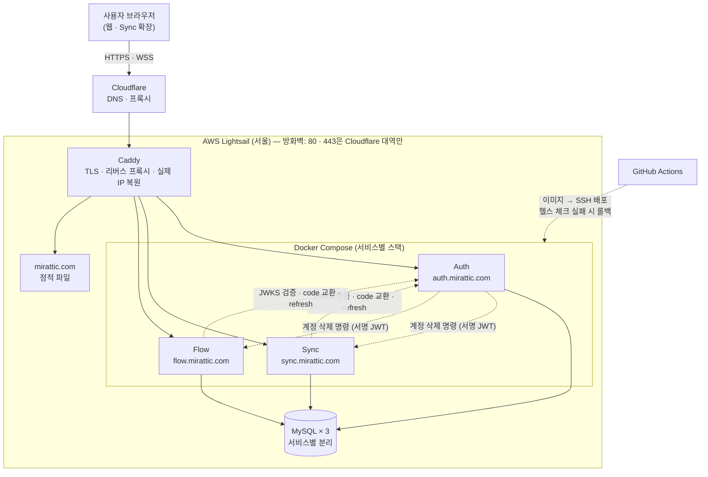

  

<h1 align="center">함께 보고, 함께 일하는 곳.</h1>

  Mirattic은 친구와 영상을 같은 순간에 보는 <b>Mirattic Sync</b>와, 
  팀이 이슈와 대화를 한곳에서 나누는 <b>Mirattic Flow</b>를 만듭니다. 
  계정 하나로 둘 다 씁니다.

  <a href="https://sync.mirattic.com"> Mirattic Sync</a>
  &nbsp;·&nbsp;
  <a href="https://flow.mirattic.com"> Mirattic Flow</a>
  &nbsp;·&nbsp;
  <a href="https://auth.mirattic.com"> 내 계정</a>

---

##  Mirattic Sync

### 친구랑 같은 영상을 같은 초에 보세요.

- **방장이 재생하면 모두 재생** — 멈추고 넘기는 것도 모두의 화면이 따라갑니다.
- **영상은 각자 브라우저에서** — 녹화하거나 중계하지 않습니다.
- **옆 패널에서 대화** — 영상을 가리지 않는 사이드 패널에서 이야기합니다.

|  YouTube |  Netflix |  라프텔 |
|:---:|:---:|:---:|
| 지원 | 실험 | 실험 |

**[Sync 살펴보기 →](https://sync.mirattic.com)**

---

##  Mirattic Flow

### 이슈와 대화를 한 화면에서.

- **워크스페이스 · 프로젝트 · 이슈** — 담당자, 우선순위, 마감일, 상태를 한눈에.
- **이슈 옆 실시간 채팅** — 이야기한 내용이 그 이슈에 남습니다.
- **알림과 대시보드** — 내 담당과 진행 상황을 놓치지 않습니다.

**[Flow 시작하기 →](https://flow.mirattic.com)**

---

##  Mirattic 계정

### 계정 하나로 모두.

- 카카오, 네이버, Google 중 편한 방법으로 가입하고 로그인합니다. Sync와 Flow에 같은 계정으로 들어갑니다.
- 비밀번호는 Mirattic 계정에서만 입력합니다. 각 서비스는 비밀번호를 받지도, 저장하지도 않습니다.
- 로그인된 기기, 최근 보안 활동, 탈퇴까지 **[내 계정](https://auth.mirattic.com)** 에서 직접 관리합니다.

---

## 시스템 구성

혼자 설계 · 구현 · 배포 · 운영하는 서비스 세 개와 소개 페이지 하나입니다. 서비스마다 저장소가 따로 있고, README에 기술 결정과 트러블슈팅을 정리했습니다.

| 저장소 | 역할 | 스택 | 핵심 |
| --- | --- | --- | --- |
| [mirattic-auth](https://github.com/G1Se0k/mirattic-auth) | 중앙 인증 서버 | Spring Authorization Server · MySQL | OAuth 2.0 / OIDC, PKCE, refresh 회전 · 재사용 탐지, 무중단 서명 키 회전, 제품 간 계정 삭제 |
| [mirattic-sync](https://github.com/G1Se0k/mirattic-sync) | 워치파티 Chrome 확장 + 서버 | Spring Boot · Raw WebSocket · MySQL · WXT/TS | 서버 시계 추정 · drift 정책, 행 잠금 기반 방 상태, 로컬 부하 테스트(M3 Max) 동시 8,000 연결 p95 73ms |
| [MiratticFlow](https://github.com/G1Se0k/MiratticFlow) | 팀 협업 · 이슈 관리 | Spring Boot · STOMP · MySQL · Next.js | 권한 검사 일원화, 실시간 채팅 · 알림, 집계는 DB에서 |
| mirattic-main (이 저장소) | mirattic.com 소개 페이지 | 정적 HTML | — |

- **인증은 한 곳에서:** Sync와 Flow는 비밀번호를 받지 않고 로그인 버튼에서 Auth로 넘기며, Auth가 발급한 토큰을 JWKS로 직접 검증합니다(서명 · `iss` · `aud` · `exp`). 계정 하나로 SSO합니다.
- **DB는 서비스마다 따로:** 서비스끼리 DB를 읽지 않고 UID(OIDC `sub`)로만 연결됩니다. 서비스를 넘나드는 작업(계정 삭제)은 Auth가 서명한 명령으로 처리합니다.
- **같은 배포 방식:** 세 서비스 모두 레지스트리 없이 CI가 만든 이미지를 SSH로 보내고, 호스트의 스크립트가 헬스 체크 뒤 교체하거나 롤백합니다. Auth · Sync는 CI 테스트를 통과해야 배포되고, 소개 페이지는 정적 파일만 복사합니다. 매일 DB를 백업하고, 5분 간격 가동 확인이 실패하면 GitHub 실패 알림으로 받습니다.
- **호스트 이전:** 2026-10-03 Mac mini 홈 서버에서 AWS Lightsail로 옮겼습니다. 실제 백업으로 리허설한 뒤, 서비스 하나씩 수 분 안에 전환했습니다.

---

이 저장소에 대하여

[mirattic.com](https://mirattic.com) 소개 페이지의 소스입니다.

- 빌드 없는 정적 페이지: `public/` (`index.html` + `assets/`). 이 폴더만 공개됩니다
- 배포: `main` 에 push → GitHub Actions 가 호스트에 SSH → `deploy/deploy.sh` 가 `public/` 을 호스트 Caddy 의 루트로 복사.
  CI 키는 호스트에서 이 스크립트만 실행할 수 있습니다
- 로컬 미리보기: `python3 -m http.server 8765 -d public` → http://127.0.0.1:8765

© 2026 Mirattic

